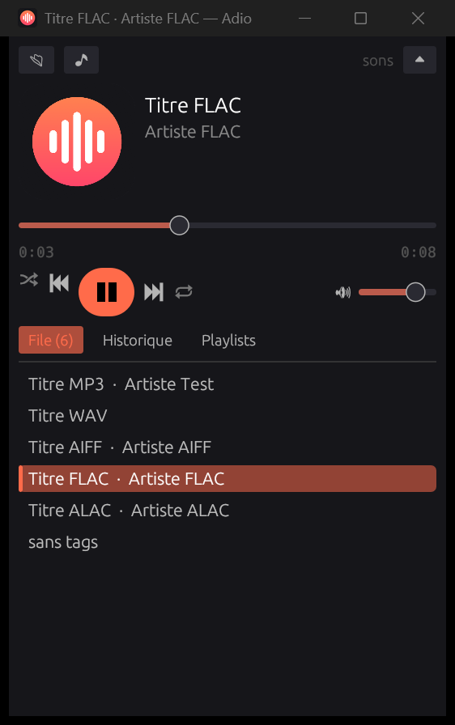

<p align="center">
  
</p>

<h1 align="center">Adio</h1>

<p align="center">
  Un petit lecteur audio portable, ultra rapide, écrit en Rust.<br>
  Un seul <code>.exe</code> de ~7 Mo, aucune installation.
</p>

<p align="center">
  <a href="https://github.com/joshsssn/Adio/releases/latest"><b>⬇ Télécharger Adio.exe</b></a>
</p>

<p align="center">
  
</p>

## Fonctionnalités

- **Lecture de dossier** : ouvre un son et Adio charge tout son dossier. *Suivant* joue le titre suivant du même dossier, en ordre naturel (`2` avant `10`).
- **Formats** : MP3, WAV, AIFF, FLAC, ALAC / AAC (`.m4a`), OGG Vorbis.
- **Pochette et tags** : affiche l'artwork intégré, le titre, l'artiste et l'album. Sans tags, le nom du fichier sert de titre.
- **Lecture aléatoire** : chaque titre passe une fois avant que le cycle recommence.
- **Répétition** : désactivée, toute la liste ou un seul titre.
- **Barre de progression** : clique ou glisse pour te déplacer dans le morceau. Volume réglable.
- **Historique** : les 1000 dernières écoutes, datées. Un clic relance le titre.
- **Playlists** : au format `.m3u8` standard, compatibles VLC, foobar2000, etc. Clic droit sur un titre → *Ajouter à une playlist*.
- **Touches multimédia** : les touches play/pause/suivant/précédent du clavier, et l'overlay média de Windows avec titre et pochette.
- **Glisser-déposer** de fichiers ou de dossiers sur la fenêtre.
- **« Ouvrir avec »** : clic droit sur un son → *Ouvrir avec* → `Adio.exe`.
- **Portable** : réglages, historique et playlists sont rangés dans `AdioData/`, à côté de l'exe. Copie le tout sur une clé USB et tout suit.
- **Léger** : démarrage instantané, ~0 % CPU en pause, mode compact (liste masquée).

## Raccourcis

| Touche | Action |
|---|---|
| `Espace` | Lecture / pause |
| `Ctrl + →` / `Ctrl + ←` | Titre suivant / précédent |
| `→` / `←` | Avancer / reculer de 5 s |
| `↑` / `↓` | Volume |
| `S` | Lecture aléatoire |
| `R` | Répétition (off → tout → un) |
| `M` | Muet |
| `Ctrl + O` | Ouvrir un dossier |

## Utilisation

1. Télécharge `Adio.exe` depuis les [Releases](https://github.com/joshsssn/Adio/releases/latest) et place-le où tu veux.
2. Lance-le, puis glisse un dossier ou un son dans la fenêtre. Tu peux aussi faire clic droit sur un son → *Ouvrir avec* → *Choisir une autre application* → `Adio.exe`.
3. Au prochain lancement, Adio reprend là où tu t'étais arrêté, en pause.

> Windows SmartScreen peut afficher un avertissement au premier lancement, car l'exe n'est pas signé. Clique sur *Informations complémentaires* puis *Exécuter quand même*.

## Compiler

Il faut [Rust](https://rustup.rs) en version stable avec la toolchain MSVC.

```sh
git clone https://github.com/joshsssn/Adio.git
cd Adio
cargo build --release
# → target/release/adio.exe
```

Le binaire est lié statiquement au runtime C (`+crt-static`), il n'a donc besoin d'aucune DLL Visual C++.

### Stack

[egui/eframe](https://github.com/emilk/egui) pour l'interface, [rodio](https://github.com/RustAudio/rodio) et [symphonia](https://github.com/pdeljanov/Symphonia) pour le décodage et la sortie audio, [lofty](https://github.com/Serial-ATA/lofty-rs) pour les tags et pochettes, [souvlaki](https://github.com/Sinono3/souvlaki) pour les touches multimédia et SMTC.

### Tests

```sh
cargo test
# test des formats sur un dossier de vrais sons :
ADIO_TEST_DIR="C:/chemin/vers/sons" cargo test formats -- --nocapture
```

## Licence

[MIT](LICENSE)
